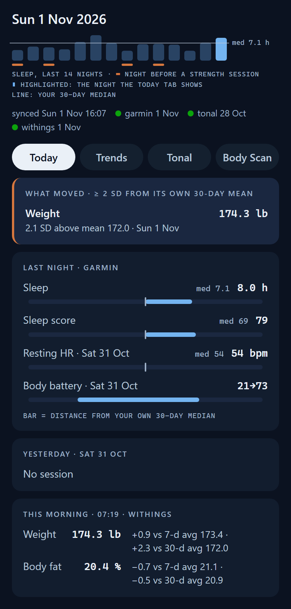
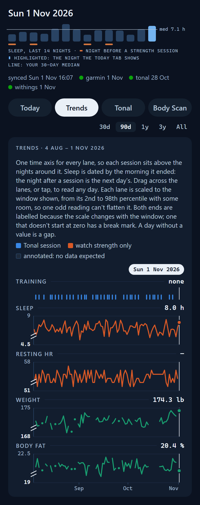
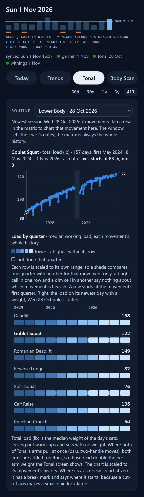
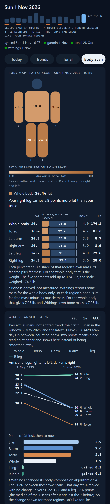
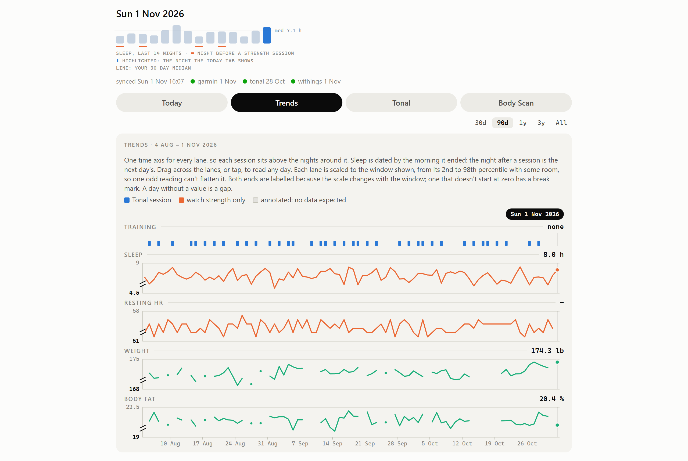

# wellness-data-layer

A local data layer that loads Garmin, Tonal and Withings data into one SQLite
file, refuses data it can prove is incomplete, and serves it to three readers
that share one set of statistics: a static dashboard, a plain-text morning
brief, and a fixed query catalog for an LLM agent.

It was written for one person's devices and runs on one always-on machine.
Nothing leaves it. There is no server, no cloud component and no telemetry.
The code is published as a worked example of the integrity design described
below. It isn't a packaged product, and you should expect to adapt it.

Not affiliated with or endorsed by Garmin, Tonal or Withings. Their names are
trademarks of their respective owners.

## Contents

- [Try it without any accounts](#try-it-without-any-accounts)
- [What it integrates](#what-it-integrates)
- [How it fits together](#how-it-fits-together)
- [The integrity design](#the-integrity-design)
- [The readers](#the-readers)
- [Running it yourself](#running-it-yourself)
- [Repository layout](#repository-layout)
- [Caveats](#caveats)
- [Acknowledgements](#acknowledgements)
- [License](#license)

## Try it without any accounts

```
git clone <this repo> && cd wellness-data-layer
python3 sync_all.py demo
```

That needs nothing but Python 3.11: no accounts, no config, no network. It
invents six years of one person's data (weight and body fat, BodyScan
segments, sleep, resting HR, body battery, two and a half years of Tonal sessions),
writes it in each source's own format, and loads it through the same
loaders and guard as real data. It exits 0 only if every source loads clean.
Then it builds the snapshot and the dashboard in `demo/`. Open
`demo/dashboard/index.html` in a browser; it needs no server.

The invented person is plausible on purpose and real on no account. Every
figure is from a published reference (the body-segment shares are
Dempster's, via Winter) or invented, and `wellness/demo.py` says which. It
includes the awkward cases the page has to handle: a night the watch didn't
record, a scale reading that is internally consistent but implausible, an
evening re-weigh, a Withings algorithm update that moves the legs overnight,
and an annotated break from Tonal. Movement names are invented too, unless
you've fetched the real catalog (`sync_all.py fetch-catalog`).

<table>
<tr>
<td></td>
<td></td>
<td></td>
<td></td>
</tr>
<tr>
<td>Today. <em>Synthetic demo data.</em></td>
<td>Trends. <em>Synthetic demo data.</em></td>
<td>Tonal. <em>Synthetic demo data.</em></td>
<td>Body Scan. <em>Synthetic demo data.</em></td>
</tr>
</table>



*Trends on a desktop, light theme. Synthetic demo data.*

## What it integrates

| Source | Fetched by | What is stored | How far it's trusted |
|---|---|---|---|
| **Garmin** (watch: sleep, resting HR, body battery, steps, stress, activities) | [GarminDB](https://github.com/tcgoetz/GarminDB), which downloads from Garmin Connect into its own SQLite files | One row per day in `garmin_daily`, one per activity in `garmin_activity`, copied from GarminDB's files opened read-only | A read-only copy. No guard, because GarminDB already keeps the raw files and can rebuild |
| **Tonal** (strength training: workouts, every set, per side) | [toneget](https://github.com/curlrequests/toneget), an unofficial exporter, with a small patch in `patches/` | `tonal_workout`, `tonal_set` (one row per set and side), movement names | Guarded and append-only. The exporter skips failed pages silently, so every export is checked against what is already stored |
| **Withings** (scale and BodyScan: weight, body composition, segmental fat and muscle, blood pressure) | The official [Withings Health API](https://developer.withings.com/), called directly | `withings_measure`, one row per measurement, with the raw value/unit pair | A documented API, but its pagination contract is enforced: a walk that doesn't finish isn't committed |

Each source keeps its own units: Tonal in lb, Withings in kg, Garmin weight in
whatever unit GarminDB was configured with (`garmin_daily.weight_lb`). Nothing
is converted in storage. The dashboard converts once, for display.

## How it fits together

```
GarminDB's SQLite ──┐
toneget export ─────┼─▶ loaders ─▶ guard ─▶ wellness.db ─▶ VACUUM INTO ─▶ wellness-ro.db
Withings API ───────┘   (garmin.py,  (verdict              (upserts,                │
                         tonal.py,    before any            never deletes)           ├─▶ dashboard (static HTML)
                         withings.py) row is written)                                ├─▶ morning brief (text)
                                                                                     └─▶ query catalog (JSON, for an agent)
```

- **`wellness.db`** is the only file the loaders write.
- **`wellness-ro.db`** is a snapshot taken with `VACUUM INTO` and swapped in
  atomically after each run. Every reader opens only the snapshot, read-only,
  so nothing ever sees a half-loaded database.
- **`sync_all.py`** runs everything: `init`, `all`, one source, `status`,
  `snapshot`, `dashboard`, `brief`, `sleep-catchup` and `ask`.

## The integrity design

The failure this project is built against is quiet data loss. A pipeline
that trusts its inputs will shrink your history without an error, and an
agent reading it will give a confident wrong answer. toneget's dropped
page is a real example: one failed page out of many leaves an export that
looks complete.

### 1. Nothing is ever deleted by a sync

Loads are upserts. When a row is updated, each column is written as
`COALESCE(new, stored)`, so a value missing from a new payload can't
overwrite one already stored. Raw payloads are archived before they are
judged and are never deleted: Tonal exports by content hash, Withings
`getmeas` pages by timestamp. A table that changes shape is renamed aside,
never dropped (`db.RETIRED`), and refilled from its stored raw JSON.

### 2. The guard: a bad export is rejected whole

`wellness/guard.py` gives a verdict before any data row is written, and an
accepted load commits in one transaction. Nothing is ever partly absorbed.

- **Tonal** history is append-only. An export is rejected if it is missing
  any workout already stored, if the workout count dropped, or if it holds
  fewer workouts than the API declared (`pagination.declaredTotal`, which the
  toneget patch records). Sets follow the same rule, keyed by each set's own
  `id`. An export is also rejected if a set has no `id` or repeats one.
- **Withings** is rejected if the `more`/`offset` pagination walk didn't
  finish. The `lastupdate` cursor only advances in the same transaction as
  the data it covers. Measurements are keyed by `grpid:meastype:position`,
  because BodyScan reports one value per body segment and `position` is the
  only thing telling them apart. Collisions on that key are counted on every
  run, so a missing discriminator can't go unnoticed again.
- **Garmin** has no guard. It is a read-only copy of GarminDB's files,
  protected by upsert + COALESCE.

Each run of each source ends in one status: `ok`, `ok_warn` (loaded, with
something worth reading), `rejected` or `error`. Every run is recorded in
`sync_runs`.

### 3. Staleness is separate from success, and has its own exit code

A load can succeed on data that has stopped advancing. GarminDB is the case
that hid for days: its download stopped, its files went stale, and the
loader kept loading them "successfully". So after every load,
`guard.evaluate_freshness` compares the newest stored day with today, against
a per-source limit (`stale_after_days`: Garmin 2, Withings 2, Tonal 14 by
default).

| Exit code | Meaning |
|---|---|
| 0 | Everything loaded. Advisory warnings included |
| 1 | At least one source was rejected |
| 2 | At least one source errored |
| 3 | Everything loaded, but at least one source's data is stale |

With more than one, the first of 2, 1, 3 wins. A stale source turns `ok` into
`ok_warn` but never blocks the others. Every other warning exits 0. This is
deliberate: the scheduler alerts on any non-zero exit, and an alert that
fires every night stops being read.

### 4. Expected gaps are recorded, not tolerated

The `annotations` table marks a stretch as expected: source, inclusive date
range, a note, and who recorded it. The guard treats annotated days as
accounted for, in the Tonal history-gap check and in staleness. A known gap
(training somewhere else, a holiday) is recorded once instead of loosening a
threshold for everyone:

```
python3 q.py "INSERT INTO annotations (source, start_date, end_date, note, recorded_by)
              VALUES ('tonal', '2026-12-20', '2027-01-03', 'Away, no Tonal', 'me')"
```

### 5. Every timestamp says how its offset was known

UTC is stored as the authoritative time, beside `local_date` in the
configured timezone and a `tz_source` saying how the offset was known
(`offset`, `z`, `epoch_s`, `epoch_ms`, `assumed_local`, `unknown`, or
`zero_time` for Tonal's never-performed sets). Rows whose day depends on a
guessed offset are flagged (`v_tonal_day.tz_uncertain`). Some Garmin and
Tonal tables don't have this yet.
`CLAUDE.md` lists those gaps.

### 6. Statistics are computed once and shared

Every derived number (30-day medians and spreads, 7- and 30-day averages,
"what moved" at 2 SD, training days, working loads, body-composition
percentages) is computed in one place, `wellness/dashboard.py`. The
dashboard, the morning brief and the query catalog all call it, so the three
can't disagree about a number. The rules it follows:

- **Missing is missing.** A day with no reading is `None` and a gap on a
  chart, never interpolated and never zero. Garmin's 0-second sleep is a
  missing night.
- **Every number carries its dates.**
- **No composite scores.** Each measurement is shown against its own history
  only, and pounds of Tonal volume are never combined with minutes of watch
  activity.
- **Too little data is said in words.** Too few readings give `insufficient`,
  not a number.

### 7. Tests

```
python3 tests/test_pipeline.py
```

A plain script, not pytest: about 450 checks against synthetic fixtures (a
fake GarminDB, Tonal exports including a truncated one, Withings payloads
including undocumented measurement types, and the demo generator's invented
BodyScan weigh-ins), with no network and no credentials. It runs the whole
demo, too. It ends with `N passed, 0 failed`.

## The readers

### Dashboard

`python3 sync_all.py dashboard` writes one static `index.html` from the
snapshot, with the data embedded as JSON and the charts drawn as plain SVG.
Nothing is fetched after the page loads. It has four tabs:

- **Today:** last night against its 30-day median, yesterday's training,
  this morning's weigh-in, and anything at least 2 SD from its own 30-day
  mean. Most days that last section is empty, and the page says so.
- **Trends:** training, recovery and body composition on one time axis.
- **Tonal:** each movement's working load over its whole history.
- **Body Scan:** Withings' segmental fat and muscle, region by region.

**The page holds your data.** Serve its own directory only, never the data
directory, and never on `0.0.0.0`.

### Morning brief

`python3 sync_all.py brief` prints a short plain-text digest of the same
numbers, for a messaging app. stdout is the digest and nothing else;
warnings go to stderr. Each reading is dated by the day it belongs to, and
one older than 3 days says how old it is.

### Query catalog for an agent

An LLM agent gets no SQL and does no arithmetic. It asks one question from
a fixed catalog and quotes the JSON it gets back:

```
scripts/ask.sh list
scripts/ask.sh metric-window metric=sleep_hours days=30
scripts/ask.sh compare-windows metric=resting_hr recent=7 prior=30
```

The queries are `list`, `latest`, `day`, `metric-window`, `compare-windows`,
`training-frequency`, `training-volume`, `recovery-after-training`, `extremes`
and `coverage`. Every window carries `from`/`to`, missing days are counted,
and the statistics are `dashboard.py`'s.

`ask.sh` is a security boundary. It assumes the caller is a prompt-injected
agent. It runs only allowlisted query names and accepts only `key=value`
arguments in a narrow character set. It ignores the caller's environment and
never echoes input back. `sync_all.py ask` then type- and range-checks every
value before anything is opened. No input reaches SQL, a shell command or an
error message.

For a model you do trust with SQL, give it read-only access to
`wellness-ro.db` and nothing else. It should start from `data_dictionary`
(plain-language notes on every table), check `v_data_health` before any
trend question, prefer the views (`v_day_all` first), and treat NULL as "no
data", never as zero.

## Running it yourself

### What you need

- Python 3.11 or newer. The layer itself uses only the standard library. The
  one exception is the optional sleep catch-up, which imports GarminDB.
- The devices and accounts you want to load. Any one source works alone.
- **Garmin:** [GarminDB](https://github.com/tcgoetz/GarminDB), configured with
  your Garmin Connect login in `~/.GarminDb/GarminConnectConfig.json`.
- **Tonal:** a clone of [toneget](https://github.com/curlrequests/toneget) with
  `patches/toneget-env-credentials.patch` applied (see `patches/README.md`).
  Without the patch, toneget prompts for a password, so it can't run
  unattended.
- **Withings:** a developer app from <https://developer.withings.com/>, for a
  client ID and secret. Its callback URL never has to load.

### Install and first run

```
git clone <this repo> && cd wellness-data-layer
cp config.example.toml config.toml        # paths, timezone, display units
export WITHINGS_CLIENT_ID=... WITHINGS_CLIENT_SECRET=...
python3 sync_all.py init                  # create wellness.db
python3 sync_all.py fetch-catalog         # Tonal movement names (optional)
python3 sync_all.py withings-auth         # one-time OAuth handshake
python3 sync_all.py all                   # load everything, then snapshot
python3 sync_all.py status                # what loaded, and how fresh it is
```

Secrets never go in `config.toml` or the repo. Environment variables always
win over the file. The Withings token file is written atomically with mode
0600, because its refresh token rotates and the old one dies 8 hours later.

Before trusting the Garmin numbers, run `python3 sync_all.py inspect-garmin`.
GarminDB's tables vary by version, so columns are found by introspection, and
`garmin_column_map` records where each one came from. Then run
`python3 sync_all.py verify-day YYYY-MM-DD` to see the raw values behind one
day.

Each Withings account may return measurement types the public docs don't
name. They are recorded as `unknown_NNN`, never dropped
(`v_withings_unknown_types`). Name one with `origin='confirmed'` so a later
schema apply won't overwrite it. `schema.sql` documents the nine BodyScan
codes named so far and how each was checked.

### Scheduling

Three scripts are written to run unattended, each taking no arguments, so
each can be allowed by a sudoers rule naming exactly one path:

- **`scripts/nightly.sh`** runs GarminDB's download and import, then toneget,
  then the loader, the snapshot and the dashboard. Run it daily, after your
  usual weigh-in.
- **`scripts/sleep_catchup.sh`** runs later the same morning. GarminDB's
  incremental download stops at yesterday, so this fetches only the night
  that ended this morning, once Garmin Connect has it. Finding nothing yet is
  a normal morning (exit 0). A day it loads holds only sleep, and freshness
  doesn't count such a day, so a working catch-up can't hide a stopped
  nightly. Each run appends one JSON line to `sleep_catchup.jsonl`: whether
  the night was there, when you woke, and the minutes between. That log
  measures whether the job runs at the right time.
- **`scripts/brief.sh`** prints the brief, for a scheduler to send on.

The scripts find the repo from their own path. Everything else has a
default you can override with an environment variable: data in
`~/HealthData` (`HEALTH_DIR`), toneget in `~/projects/toneget`
(`TONEGET_DIR`), and a Python with GarminDB installed in
`~/projects/health-venv` (`PY`). `nightly.sh` reads `WITHINGS_CLIENT_ID`,
`WITHINGS_CLIENT_SECRET`, `TONAL_EMAIL` and `TONAL_PASSWORD` from
`~/.secrets/sync.env` (`SECRETS_ENV`), which should be mode 0600. Its last
step, and the catch-up's, can copy the page to a folder another machine
serves (on WSL2, say, a Windows folder): put `PUBLISH_DIR=/that/folder` in
`local.env` in the repo, which is gitignored and read, never sourced.
Without it the step is skipped.

### Notes for WSL2

The layer runs fine in WSL2, with two rules:

- **Keep the repo and the data on the Linux filesystem**, not under
  `/mnt/c`. SQLite's WAL mode needs file locking and shared memory that
  Windows-drive mounts don't reliably provide, `chmod 0600` is silently
  ignored there, and CRLF line endings break the scripts' shebangs.
- **Schedule from Windows**, not from cron inside WSL, which only runs while
  WSL is up. In Task Scheduler, run `wsl.exe` with the arguments
  `-d Ubuntu -- bash -lc "~/projects/wellness-data-layer/scripts/nightly.sh"`,
  and tick "Run whether user is logged on or not".

To browse the snapshot from other devices, serve it on `127.0.0.1` inside
WSL. Then publish that port from the Windows side with something like
`tailscale serve`, or switch WSL to mirrored networking. Never bind to
`0.0.0.0`: this database holds blood pressure and body composition history.
[Datasette](https://datasette.io/) works well for browsing:
`datasette serve wellness-ro.db --host 127.0.0.1`.

### Before you commit

`scripts/leakcheck.sh` checks what is staged for anything that looks like
data (databases, journals, logs, exports, a generated page, any JSON not on
the allowlist, files over 1 MB). It also checks history for data files ever
added, and tracked files for literal credentials. With a gitignored
`.leakcheck-terms` file, it also searches for your own strings: name, paths,
ids. `--history` extends the credential and personal-string searches to
every commit. It exits non-zero on any hit. To run it on every commit, opt in
once per clone with `git config core.hooksPath .githooks`.

## Repository layout

```
sync_all.py              the command line: every command goes through here
wellness/
  garmin.py              copies GarminDB's daily and activity data, read-only
  tonal.py               loads toneget exports: workouts, sets, movements
  withings.py            the Withings OAuth client and measurement loader
  guard.py               verdicts, freshness, partition checks
  db.py                  schema apply, column renames, retired tables
  dashboard.py           every statistic, and the dashboard payload
  dashboard.html         the page template (no data in it)
  brief.py               words the brief, from dashboard.py's numbers
  ask.py                 the query catalog
  sleep_catchup.py       the morning sleep fetch, through GarminDB
  demo.py                the invented dataset behind `sync_all.py demo`
schema.sql               tables, views and seeds; re-applied before every command
reference/               names for Tonal movements; the catalog itself is downloaded
patches/                 the toneget patch the nightly run depends on
scripts/                 the scheduled scripts, ask.sh, and leakcheck.sh
tests/test_pipeline.py   the test suite
docs/screenshots/        the README's screenshots, from the demo
CLAUDE.md                the rules for changing the code: invariants and known gaps
```

`CLAUDE.md` is written for whoever changes the code next, human or model.
Read its invariants before changing a loader or the schema.

## Caveats

- **Garmin's login breaks from time to time** across every Garmin tool,
  usually around MFA. GarminDB keeps its raw files, so a breakage costs new
  data, not old data.
- **toneget uses Tonal's private API.** Automated access may conflict with
  Tonal's Terms of Service. That's your call to make, not a technical
  question.
- **GarminDB is GPL-2.0**, and the sleep catch-up imports it at runtime. See
  [License](#license).

## Acknowledgements

This project stands on other people's work. Nothing listed here is
redistributed in this repo, except where a row says so.

| Project | What it is | What it's used for here | Where it lives | License |
|---|---|---|---|---|
| **GarminDB**, by Tom Goetz | Downloads Garmin Connect data (FIT files and JSON) and builds SQLite databases from it | All Garmin downloading and parsing. The loader reads GarminDB's databases read-only. The sleep catch-up imports GarminDB's `Download`, `GarminConnectConfigManager` and `GarminSleepData`, reuses its login and its sleep request, and imports the night with GarminDB's own importer. Tested with 3.9.0 | <https://github.com/tcgoetz/GarminDB>, installed separately (`pip install garmindb`) | GPL-2.0 |
| **python-garminconnect**, by cyberjunky | A Python client for Garmin Connect | GarminDB's login and requests go through it. Used only by way of GarminDB, never imported here | <https://github.com/cyberjunky/python-garminconnect> | MIT |
| **toneget**, by curlrequests | An unofficial exporter for Tonal workout history | Produces the Tonal exports this loader reads. Cloned and run separately. `patches/toneget-env-credentials.patch` is a change to it, made against upstream commit `ec29fb5`, which reads credentials from the environment and records how many pages failed. The loader and tests are shaped on its v3.1.0 export format | <https://github.com/curlrequests/toneget> | MIT, per its LICENSE file. The copyright line names no holder, so GitHub doesn't detect it. The patch quotes a few lines of toneget's code as context |
| **Tonal Movement Library**, a gist by BrianVia | A JSON list of 286 Tonal movements, keyed by the UUIDs that Tonal's export uses | Movement names, muscle groups, body region, sidedness and whether both arms pull together. **Not redistributed:** `sync_all.py fetch-catalog` downloads gist revision `623fa360af417e73fe7015e76a269780d5d2e344` (2025-02-03) to `reference/tonal-movements.json`, which is gitignored, and installs it only if its sha256 matches. `reference/README.md` has the details | <https://gist.github.com/BrianVia/aa79415d999696b50cc4aff9bc1f9f0c> | None stated. The content appears to come from Tonal's own API |
| **Dempster's segment parameters**, as tabulated in Winter, *Biomechanics and Motor Control of Human Movement*, 4th ed. (Wiley, 2009), Table 4.1 | Published shares of body mass by segment | The demo's invented BodyScan segments split the body by these shares, so the demo body has textbook proportions, not anyone's | Cited in `wellness/demo.py` | Facts from a published table |
| **American Council on Exercise**, body-fat categories | Published body-fat ranges for women and men | The span of the Body Scan map's colour ramp (10% to 30%) was chosen to cover them. The anchors themselves are invented | Cited in `wellness/dashboard.py` | Facts from a published table |
| **aiowithings** (python-withings), by Joost Lekkerkerker | An async Python client for the Withings API, used by Home Assistant | Its published `MeasurementType` enum named nine BodyScan measurement codes that Withings' public reference doesn't list (155, 168-170, 196-198, 226, 227). We read the names from `src/aiowithings/models.py` (as of commit `e9ee67b`) and checked each against real data. **It is not imported or installed.** Only the names were taken | <https://github.com/joostlek/python-withings> | MIT |
| **Withings Public API** | Withings' documented Health API and its reference | OAuth2, `getmeas`, the measurement-type table, the `value × 10^unit` encoding and the pagination contract the guard enforces | <https://developer.withings.com/> | Withings' developer terms |
| **WCAG 2.x**, W3C | Accessibility guidelines | The tests check the dashboard's colours with WCAG's relative-luminance contrast ratio (3:1 for marks, 4.5:1 for text) | <https://www.w3.org/TR/WCAG21/#dfn-contrast-ratio> | W3C document |
| **OKLab**, by Björn Ottosson | A perceptual colour space | Colour differences quoted in comments for the Body Scan palette are OKLab distances. No code from it is included | <https://bottosson.github.io/posts/oklab/> | Not applicable |
| **Datasette**, by Simon Willison | A tool for browsing SQLite databases | Suggested for browsing the snapshot. Optional, not required | <https://datasette.io/> | Apache-2.0 |

The deployment around it uses other tools it doesn't include: an agent
runtime (OpenClaw) that calls the scheduled scripts and `ask.sh`, a
messaging app that receives the brief, and Tailscale for reaching the
dashboard from a phone.

## License

MIT, in `LICENSE`. That covers this repository's code and docs only.

GarminDB is GPL-2.0, and `wellness/sleep_catchup.py` imports it at run time
(only that module, and only when a run needs it). This repo doesn't include
or redistribute GarminDB: you install it yourself. MIT is compatible with
GPL-2.0, but if you distribute this code together with GarminDB, the
combination falls under GarminDB's GPL-2.0 terms. The rest of the layer,
the demo included, runs without GarminDB.
